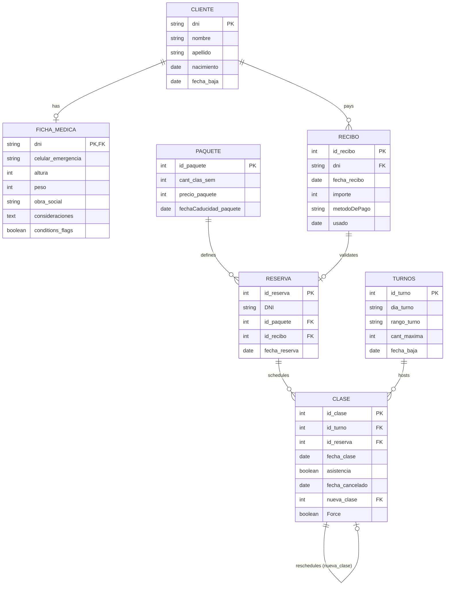

# 🏊‍♀️ AquaPilates — Studio & Class Management System


A full-stack web application built with **Django 5** designed to streamline daily operations for an Aqua Pilates fitness studio. It centralizes client registration, medical history tracking, shift capacity management, subscription packages, payment receipts, and automated class scheduling.

---

## ✨ Key Features

- **👥 Client & Medical Record Management (`Aplicaciones.clientes`)**
  - Client registration indexed by national ID (`DNI`), birth date, and active/inactive lifecycle status.
  - One-to-one comprehensive **Medical Record (`FichaMedica`)** tracking emergency contacts, health insurance (`obra_social`), physical metrics, and 14 pre-existing medical conditions (injuries, surgeries, cardiovascular conditions, asthma, hypertension, etc.).
- **🕒 Shift & Capacity Control (`Aplicaciones.Turnos`)**
  - Configurable weekly time slots (`Turnos`) with day-of-week, time range, maximum student quota (`cant_maxima`), and soft-deletion support (`fecha_baja`).
  - Real-time availability lookup filtering out full or deactivated shifts.
- **📦 Subscription Packages (`Aplicaciones.Paquetes`)**
  - Customizable class packages defining weekly class frequency (`cant_clas_sem`), pricing (`precio_paquete`), and expiration dates.
- **📅 Automated Class Scheduling & Billing (`Aplicaciones.Clases`)**
  - **Payment Receipts (`Recibo`)**: Issues receipts per client with payment method tracking and single-use validation (`usado`) to prevent duplicate bookings.
  - **Reservations (`Reserva`)**: Links a client, a selected package, and a validated payment receipt.
  - **Class Sessions (`Clase`)**: Generates recurring monthly class schedules based on client shift preferences or custom date selection, tracks attendance (`asistencia`), instructor notes (`observaciones`, `preparacion`), cancellations (`fecha_cancelado`), and supports class rescheduling (`nueva_clase` self-referential foreign key) and administrative capacity overrides (`Force`).
- **🔐 Role-Based Access & Authentication**
  - Built-in Django authentication protecting administrative workflows and studio management views.

---

## 🏗️ Domain Model



---

## 📁 Project Structure

```text
Aquapilates/
├── Aplicaciones/
│   ├── clientes/          # Client CRUD & Medical Record (FichaMedica) module
│   ├── Turnos/            # Weekly time slots & capacity management module
│   ├── Paquetes/          # Subscription packages & pricing module
│   └── Clases/            # Billing receipts, reservations & class scheduling engine
├── AquaPilates/           # Project-level configuration, URLs, WSGI/ASGI
│   ├── settings.py        # Environment-driven Django settings
│   └── urls.py            # Root URL routing
├── staticfiles/           # Collected static assets
├── .env.example           # Environment variables template
├── manage.py              # Django CLI utility
└── requirements.txt       # Python dependencies
```

---

## 🚀 Getting Started

### Prerequisites

- **Python** 3.11+
- **pip** and `venv`

### 1. Clone the repository

```bash
git clone https://github.com/sarquis12/Aquapilates.git
cd Aquapilates
```

### 2. Create and activate a virtual environment

```bash
# Windows
python -m venv venv
venv\Scripts\activate

# Linux / macOS
python3 -m venv venv
source venv/bin/activate
```

### 3. Install dependencies

```bash
pip install -r requirements.txt
```

### 4. Configure environment variables

Copy the example environment file and adjust values as needed:

```bash
cp .env.example .env
```

| Variable | Description | Default |
| :--- | :--- | :--- |
| `DJANGO_SECRET_KEY` | Cryptographic signing key for sessions and tokens | Auto-generated fallback in dev |
| `DJANGO_DEBUG` | Enables Django debug mode (`True` / `False`) | `False` |
| `DJANGO_ALLOWED_HOSTS` | Comma-separated list of allowed hostnames | `localhost,127.0.0.1` |
| `DB_NAME` | SQLite database filename | `db.sqlite3` |

### 5. Run database migrations & create a superuser

```bash
python manage.py migrate
python manage.py createsuperuser
```

### 6. Start the development server

```bash
DJANGO_DEBUG=True python manage.py runserver
```

The application will be available at `http://localhost:8000/`.

---

## 👤 Author

**Elias Yusef Sarquis Boutros**
- [LinkedIn](https://www.linkedin.com/in/elias-yusef-sarquis-boutros)
- [GitHub](https://github.com/sarquis12)
